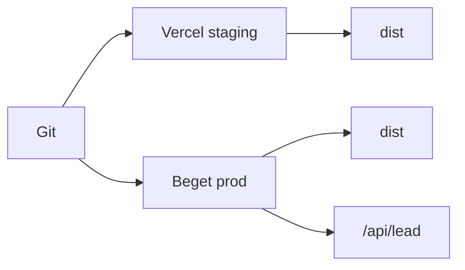

# Деплой

## Роли площадок

| Площадка | Роль | Что крутится |
|---|---|---|
| **Beget** | прод | статика `dist/` + будущий `/api/lead` |
| **Vercel** | стейджинг / Preview | только статика из `dist/` |

SSR-адаптеры и serverless-функции для заявок **не** используем. API и секреты каналов — только на Beget (см. [leads.md](./leads.md)).

## Сборка

- Команда: `npm run build` → output: `dist/`
- Конфиг стейджинга: [`vercel.json`](../../vercel.json) (без секретов заявок; индексация и Callibri выключены)
- Локально: `npm run check` и `npm run build` перед выкладкой

## URL, canonical, robots

Приоритет `site` в [`astro.config.mjs`](../../astro.config.mjs):

1. `PUBLIC_SITE_URL` — явный домен (прод на Beget)
2. `VERCEL_URL` — Vercel подставляет при сборке
3. иначе `https://example.com` (плейсхолдер до реального домена)

Индексация:

- прод: `PUBLIC_INDEXING_ENABLED=true` → `Allow` + Sitemap
- Vercel staging: в `vercel.json` стоит `false` → `Disallow: /`

## Форма на стейджинге

Клиент шлёт заявку **только** если задан `PUBLIC_LEAD_ENDPOINT`. На Vercel переменную не задаём: UI валидирует и показывает успех, сеть и Telegram/Max/почта не вызываются.

На Vercel **не** добавлять: `SMTP_*`, `TELEGRAM_*`, `MAX_*`, `PUBLIC_LEAD_ENDPOINT`.

## Env на Vercel (стейджинг)

В Project → Settings → Environment Variables:

- не копировать прод-секреты с Beget
- `PUBLIC_INDEXING_ENABLED` и `PUBLIC_CALLIBRI_ENABLED` уже заданы в `vercel.json` как `false`
- `PUBLIC_LEAD_ENDPOINT` не задавать

Preview Deployments для PR — ревью вёрстки без выкладки на Beget.

## Прод на Beget

Способ выкладки (ручной upload `dist/` или CI) ещё открыт. При сборке прода задать:

- `PUBLIC_SITE_URL=https://<реальный-домен>`
- `PUBLIC_INDEXING_ENABLED=true`
- `PUBLIC_LEAD_ENDPOINT=/api/lead` (когда эндпоинт будет готов)
- секреты каналов вне публичной папки
