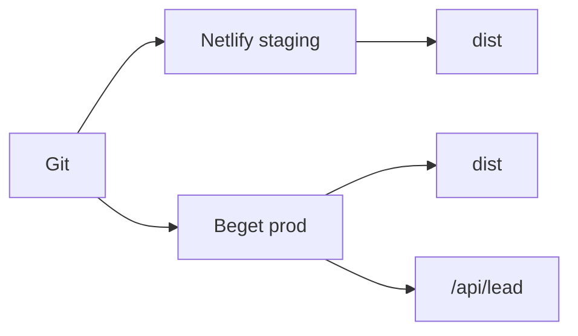

# Деплой

## Роли площадок

| Площадка | Роль | Что крутится |
|---|---|---|
| **Beget** | прод | статика `dist/` + будущий `/api/lead` |
| **Netlify** | стейджинг / Deploy Preview | только статика из `dist/` |

SSR-адаптеры и Netlify Functions для заявок **не** используем. API и секреты каналов — только на Beget (см. [leads.md](./leads.md)).

## Сборка

- Команда: `npm run build` → каталог `publish`: `dist/`
- Конфиг стейджинга: [`netlify.toml`](../../netlify.toml) (Node 22, без секретов заявок)
- Локально: `npm run check` и `npm run build` перед выкладкой

## URL, canonical, robots

Приоритет `site` в [`astro.config.mjs`](../../astro.config.mjs):

1. `PUBLIC_SITE_URL` — явный домен (прод на Beget)
2. `DEPLOY_PRIME_URL` или `URL` — Netlify подставляет при сборке
3. иначе `https://example.com` (плейсхолдер до реального домена)

Индексация:

- прод: `PUBLIC_INDEXING_ENABLED=true` → `Allow` + Sitemap
- Netlify: в `netlify.toml` стоит `false` → `Disallow: /`

## Форма на стейджинге

Клиент шлёт заявку **только** если задан `PUBLIC_LEAD_ENDPOINT`. На Netlify переменную не задаём: UI валидирует и показывает успех, сеть и Telegram/Max/почта не вызываются.

На Netlify **не** добавлять: `SMTP_*`, `TELEGRAM_*`, `MAX_*`, `PUBLIC_LEAD_ENDPOINT`.

Допустимо: `PUBLIC_CALLIBRI_ENABLED=false` (уже в `netlify.toml`).

## Подключение Netlify (вручную в UI)

1. [app.netlify.com](https://app.netlify.com) → Add new site → Import an existing project.
2. Выбрать Git-репозиторий monolit.
3. Build settings подтянутся из `netlify.toml` (`npm run build`, publish `dist`, Node 22).
4. Env: не копировать прод-секреты из `.env` Beget. При необходимости проверить, что `PUBLIC_INDEXING_ENABLED=false` и Callibri выключен.
5. Deploy site → убедиться, что билд зелёный и страница открывается.
6. Включить Deploy Previews для PR (по умолчанию обычно включены) — ревью вёрстки без выкладки на Beget.

CLI (опционально): `npx netlify deploy` / `npx netlify deploy --prod` для ручной выкладки стейджинга без Git.

## Прод на Beget

Способ выкладки (ручной upload `dist/` или CI) ещё открыт. При сборке прода задать:

- `PUBLIC_SITE_URL=https://<реальный-домен>`
- `PUBLIC_INDEXING_ENABLED=true`
- `PUBLIC_LEAD_ENDPOINT=/api/lead` (когда эндпоинт будет готов)
- секреты каналов вне публичной папки
